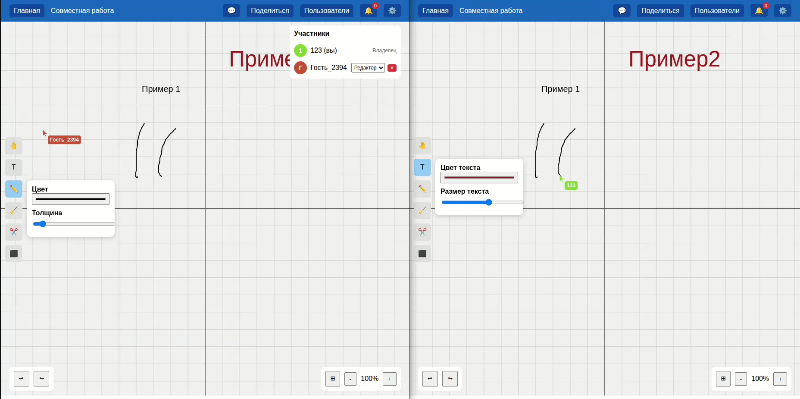
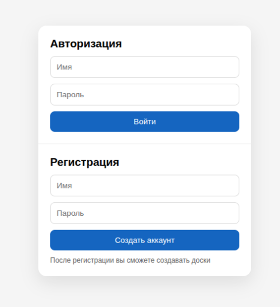
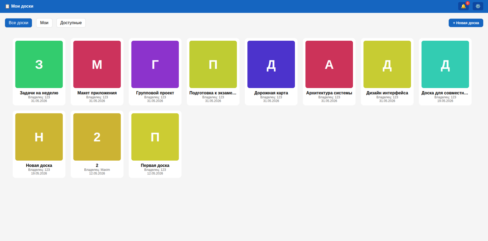
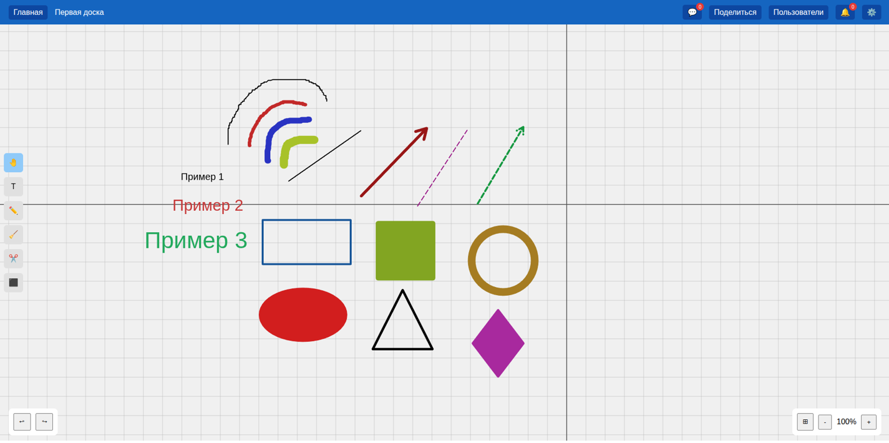
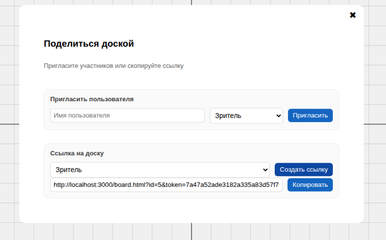
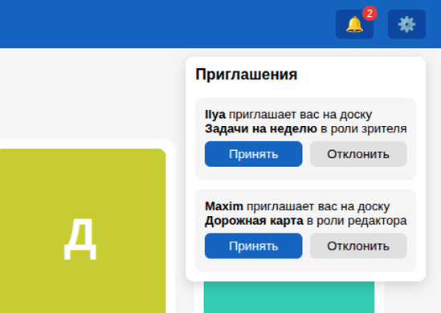
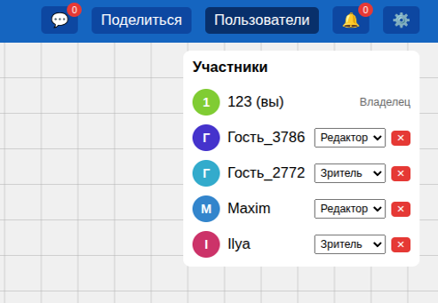
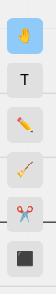
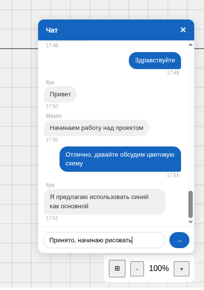
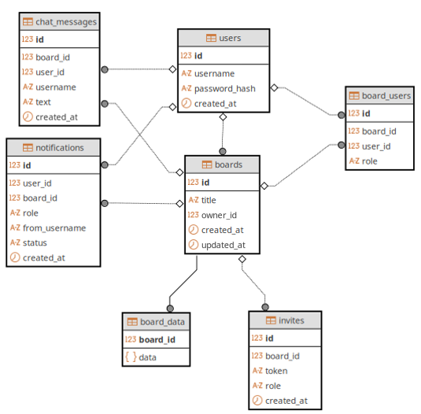

<div align="center">

# Online Whiteboard

**Веб-приложение для совместной работы на интерактивной онлайн-доске в режиме реального времени**




</div>

---

## О проекте

Online Whiteboard — полнофункциональное клиент-серверное веб-приложение, в котором несколько человек одновременно рисуют, пишут текст и строят схемы на общем холсте. Все изменения мгновенно синхронизируются между участниками по WebSocket и сохраняются в PostgreSQL, поэтому доска доступна и после перезапуска сервера.

Проект выполнен как выпускная квалификационная работа: от анализа существующих решений и формулирования требований до проектирования, реализации, развёртывания и тестирования.

## Возможности

**Совместная работа**
- Мгновенная синхронизация рисования, текста, фигур и перемещения объектов у всех участников
- Курсоры других пользователей с подписями имён
- Список участников на доске в реальном времени
- Текстовый чат доски с сохранением истории

**Инструменты**
- Свободное рисование (цвет, толщина)
- Текст (размер, цвет)
- Фигуры: линия, стрелка, пунктирные линия и стрелка, прямоугольник, квадрат, круг, эллипс, треугольник, ромб (цвет, толщина рамки, заливка)
- Ластик, выделение области и групповое перемещение
- Undo / Redo
- Масштабирование (колесо мыши / кнопки), перемещение по холсту, переключаемая сетка

**Доступ и безопасность**
- Регистрация и вход, пароли хранятся только в виде хеша bcrypt
- Три роли: **владелец**, **редактор**, **зритель**
- Приглашения по имени пользователя (с уведомлением) и по ссылке (гость без регистрации)
- Права проверяются на сервере: действия зрителя игнорируются, даже если отправить событие напрямую через WebSocket

**Управление досками**
- Создание, переименование, удаление
- Фильтры «Все / Мои / Доступные»
- Уведомления о приглашениях: принять или отклонить, доска появляется без перезагрузки страницы

---

## Скриншоты

| Вход и регистрация | Дашборд с досками |
| :---: | :---: |
|  |  |

| Рабочая область доски | Приглашение участников |
| :---: | :---: |
|  |  |

| Приглашение уведомлений | Панель пользователей и роли |
| :---: | :---: |
|  |  |

| Инструменты и фигуры | Чат доски |
| :---: | :---: |
|  |  |

---

## Технологический стек

| Слой | Технологии |
| --- | --- |
| **Клиент** | HTML, CSS, JavaScript, Canvas API |
| **Сервер** | Node.js, Express |
| **Реальное время** | Socket.IO (WebSocket), комнаты по доскам |
| **База данных** | PostgreSQL |
| **Безопасность** | bcrypt |
| **Инфраструктура** | Docker, Docker Compose |

---

## Запуск

Нужны [Git](https://git-scm.com/) и [Docker Desktop](https://www.docker.com/products/docker-desktop/).

```bash
git clone https://github.com/MaksKLN/Online-whiteboard.git
cd Online-whiteboard
docker compose up --build
```

Приложение будет доступно по адресу **http://localhost:3000**. PostgreSQL поднимается в соседнем контейнере, таблицы создаются автоматически из `init.sql`.

Остановка: `Ctrl+C`, затем `docker compose down` (чтобы дополнительно удалить данные БД: `docker compose down -v`).


### Как проверить совместную работу

1. Зарегистрируйтесь и создайте доску на дашборде.
2. Нажмите «Поделиться» и сгенерируйте ссылку-приглашение с ролью «редактор».
3. Откройте ссылку в другом браузере или в режиме инкогнито — гость сможет рисовать без регистрации, а вы увидите его курсор и штрихи в реальном времени.

---

## База данных

Семь таблиц PostgreSQL: `users`, `boards`, `board_users`, `board_data` (содержимое доски в **JSONB**), `invites`, `notifications`, `chat_messages`.



---

## Структура проекта

```
Online-whiteboard/
├── public/                 # клиентская часть
│   ├── index.html          # вход и регистрация
│   ├── dashboard.html      # управление досками
│   ├── board.html          # рабочая область доски
│   └── app.js
├── server.js               # HTTP-эндпоинты и обработчики Socket.IO
├── init.sql                # схема базы данных
├── Dockerfile
├── docker-compose.yml      # приложение + PostgreSQL
└── package.json
```

---

## Планы развития

- Стикеры и шаблоны досок
- Загрузка изображений на холст
- Экспорт доски в графический формат
- Голосовой чат
- Мобильная версия с сенсорным вводом

---

## Автор

Клюшин Максим · [@MaksKLN](https://github.com/MaksKLN)

Проект создан в рамках выпускной квалификационной работы бакалавра.
